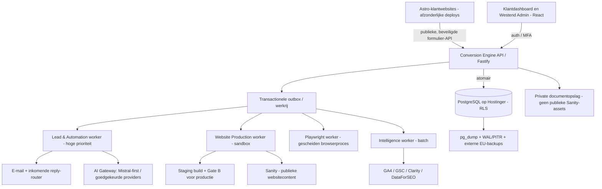

# Westend Digital — Conversion Engine
## Fase 4 · Technische architectuur & implementatiegereedheid v1.0

**Datum:** 18 oktober 2026  
**Status:** definitief goedgekeurd op 18 oktober 2026 — architectuurbaseline voor Fase 5  
**Bronbasis:** Fase 2 Requirements & Scope v1.0; Fase 3 UX/UI & User Flows v1.0; A-01 t/m A-10 en latere expliciete bijstellingen.  
**Doel:** één consistente architectuurbaseline met controleerbare releasevoorwaarden en een realistische ontwikkelvolgorde.

> **Samenvattend oordeel:** **GO voor technische uitwerking en ontwikkeling in lokale/stagingomgevingen; NO-GO voor productie met echte klantgegevens totdat de P0-veiligheids-, herstel- en operationele eisen aantoonbaar zijn bewezen.** De kernarchitectuur is goedgekeurd; enkele leveranciers, concrete deploymentconfiguraties en herstelmechanismen staan nog open.

## 1. Besluitenregister A-01 t/m A-10

| ID | Besluit | Beslisstatus | Technisch voorbehoud / toets |
|---|---|---|---|
| A-01 | Eén modulaire centrale Conversion Engine; vier logisch gescheiden workerrollen; klantwebsites onafhankelijk gedeployd | Goedgekeurd | Geen vier verplichte microservices of servers; leadopslag onafhankelijk van AI |
| A-02 | Eén gedeelde relationele PostgreSQL-database; strikte tenantisolatie met backendautorisatie, RLS en tenantveilige relaties | Goedgekeurd | Cross-tenant tests, connection pooling en werkelijke DB-rollen toetsen |
| A-03 | Beheerde of zorgvuldig beheerde auth, rollen, sessies en audit; **MFA verplicht voor Platform Admin, Business Owner en Team Member** | Goedgekeurd | Identityprovider en herstelprocedures nog kiezen, AAL/MFA server-side afdwingen |
| A-04 | Genormaliseerd datamodel; organisatie kan meerdere websites bezitten, Basis één actieve; financiële ontvangsten/correcties traceerbaar | Goedgekeurd | Concrete SQL-DDL, RLS-policies en migraties volgen in implementatievoorbereiding |
| A-05 | Transactional outbox, betrouwbare jobs, aparte capaciteit/prioriteiten voor lead, productie, monitoring en intelligence | Goedgekeurd | pg-boss voorkeurskandidaat; retries, dubbele verwerking en queue-isolatie testen |
| A-06 | Deterministische workflow-engine; AI maximaal één inhoudelijke reactie, policy-based opvolging; **prompt-injectieverdediging is P0** | Goedgekeurd | Adversarial tests, tool-/providerrechten en fail-closed gedrag |
| A-07 | Centrale veilige integratielaag, scoped credentials, webhookvalidatie, privacyvriendelijke **reply-router** zonder mailboxread | Goedgekeurd | Inbound e-mailprovider en antwoordcorrelatie nog aantonen |
| A-08 | Hybride model; eigen **Hostinger-VPS** in de EU voor centrale app en klantdata; onafhankelijke klantwebsites via **Cloudflare Pages**; geïsoleerde zware runners | Goedgekeurd, providerkeuze bijgewerkt | VPS-locatie/resources controleren; sandbox- en netwerkisolatie bewijzen |
| A-09 | Astro, React/TS, Node/Fastify, PostgreSQL, Drizzle, Sanity, Playwright, Docker/CI; **Mistral-first** met geëvalueerde alternatieven; GA4/GSC/Clarity/DataForSEO blijven | Kernstack goedgekeurd | E-mailprovider, recovery/backups, VPS-resources en Sanity-projectmodel verder uitwerken |
| A-10 | Per-tenant kostenregistratie, AI/e-mailbudgetalerts, supportmeting en schaalvergroting op echte belasting; Basis €249/mnd | Goedgekeurd | Kostenmodel indicatief, nog geen offerte of nettowinstbegroting |

**Nadere beslissing na A-09:** voor start/pilot **zelfgehoste PostgreSQL in Docker op bestaande Hostinger-VPS**. Dure managed PostgreSQL wordt nu niet afgenomen; eventueel later migreren. Iedere nacht `pg_dump`/versleutelde offsite EU-backup, rotatie 7 dagen dagelijks / 4 weken / 6 maanden, alerting en maandelijkse restauratietest zijn goedgekeurd. Het voorlopige **RPO ≤ 1 uur / RTO ≤ 4 uur** blijft doel voor productie met echte klant-/financiële gegevens en vereist WAL/PITR en een bewezen herstelprocedure. Dagelijkse dumps alleen halen het RPO-doel niet.

**Aanvullende beslissing — 23 oktober 2026:** statische klantwebsites worden standaard via **Cloudflare Pages** gedeployed vanuit Git. Cloudflare Pages verzorgt de onafhankelijke website-deployments, previews, custom domains en CDN-distributie. De Conversion Engine blijft de bron voor klant-, lead- en CRM-data; formulierdata wordt niet blijvend bij de websitehost opgeslagen. De exacte DNS-, formulier- en rollback-inrichting blijft onderdeel van de deploymentuitwerking.

## 2. Geconsolideerde doelarchitectuur

### 2.1 Architectuurprincipes

- **Modulaire monoliet:** domeinen gescheiden in code, contracten en autorisatie; geen vroegtijdige microservices.
- **De database is de bron van waarheid:** voor leads, deals, afspraken, daadwerkelijk handmatig geregistreerde ontvangsten, goedkeuringen en events. GA4 is geen CRM-bron.
- **Multi-tenant is een veiligheidsgrens:** applicatierol, membership en recordtoewijzing + PostgreSQL-RLS + samengestelde tenant-foreign keys waar relevant. Geen tenantwaarde blind vertrouwen uit browser, job of webhook.
- **Betrouwbaar boven intelligent:** AI-, mail- of provideruitval mag vastlegging van een geldige lead niet blokkeren. Onduidelijke verzendstatus leidt niet tot blind opnieuw verzenden.
- **AI is adviserend:** externe brondata is onvertrouwd; backendpolicies en mensen bepalen acties, verzending, scope en publicatie.
- **Klantwebsites zijn onafhankelijk:** individuele deploy, rollback, domein, contentconfig en origin van een lead. Geen eigen CRM-backend per site.
- **Opslag gescheiden naar gevoeligheid:** Sanity voor websitecontent; CRM en financiële records in PostgreSQL; vertrouwelijke bijlagen in niet-publieke objectopslag.
- **European-first maar pragmatisch:** Hostinger behouden (EU-datacenter nog verifiëren), Sanity behouden, Mistral-first; andere modellen als kwaliteitswinst en AVG/vendor-toets dit toelaten; Google/Microsoft analytische koppelingen toegestaan.

## 3. Kritieke ketens en consistente productgrenzen

| Keten | Minimale werking | Verboden koppeling / uitzondering |
|---|---|---|
| Websitebezoeker → formulier → CRM | Valideer/rate limit → submission+outbox in één transactie → worker → CRM/AI | Geen AI-call voor duurzame opslag; geen vertrouwen in browsergestuurd tenant-ID |
| Lead → eerste AI-antwoord | Classificeer, policycheck, streng outputcontract, max één inhoudelijke AI-reply | Geen toolbevoegdheid om bedragen, tenant, ontvanger of webhooks te wijzigen |
| Follow-up → menselijke overname | Max één toegestane vooraf goedgekeurde reminder na 48 uur als aantoonbaar geen antwoord; na verdere 48 uur menselijke taak | Bij onbekende reply-status geen automatische reminder; geen mailboxbreed uitlezen |
| Commerciële conversie → onboarding | Overeenkomst → tenant/Owner uitnodigen met MFA → Q1–Q4 met 39 directe kernvragen plus gerichte vervolgvragen | Onboarding niet vóór verkoop; geen verlies van de 123 bewaarde datavelden |
| Project Brief → site | Conversion Engine control plane: Project Brief + Demo Design Baseline + Design Change Set + Production Prompt Package → geïsoleerd klantproject voor sandboxed AI-productie → staging/QA → klantinhoud akkoord + Gate B → deployment | Geen automatische productie zonder Gate A, geen publicatie zonder Gate B; klantproject ontvangt alleen goedgekeurde tenantdata |
| Formuliermonitoring | UI-check elke 30 min **zonder** backend-submit; veilige volledige synthetische test iedere 3 dagen | Geen testleads in salesstatistiek; geen commerciële AI/e-mail/reminderflow |
| Website Intelligence | GA4, GSC, Clarity, DataForSEO snapshots → brongebonden maandadvies → Westend-review | Geen niet-bestaande demografie, identificatie van onbekende bezoekers of auto-publicatie |
| Financiële rapportage | Dealprojectie ≠ gewonnen contract ≠ handmatig vastgelegde ontvangst; auditbare correcties | Geen betaalverwerking, facturatie of boekhoudvervanging in Basis |

**MVP-scope blijft gelijk aan Fase 2.** €999 standaardimplementatie en €249 Basis p/m; één actieve website, één leadmagnet, drie gemonitorde formulieren, Owner + twee Team Members, fair-use 500 AI-processings/maand, 2.000 operationele e-mails en 1 GB CRM-bijlagen. Geen automatische leadblokkade door quota. Growth (€499) met uitgebreidere automations, volledig klantgestuurd CMS en zelfstandig SEO-publiceren zijn geen verplichtingen van de MVP. Support blijft e-mail/formulier, geen intern ticketsysteem.

## 4. Technische conflicten en correcties uit deze review

| Nr | Geconstateerd spanningsveld | Geconsolideerde regel | Prioriteit |
|---|---|---|---|
| C-01 | Dagelijkse dumps geven tot circa 24 uur dataverlies, terwijl eerder RPO 1 uur als doel is vastgesteld | Dagelijkse dumps voor ontwikkeling; vóór productie met echte klantdata WAL/PITR, onafhankelijke kopieën en hersteloefening aantonen | P0 |
| C-02 | App, Postgres en workers op één Hostinger-VPS zijn een single point of failure | Pilotopzet toegestaan als risico is beschreven en gemonitord; backup is geen high availability, uitwijk/herstart + alerting verplicht | P0 |
| C-03 | Authprovider nog open, MFA wel verplicht voor iedere rol | Geen productielogin zonder server-side verplichte MFA, veilige enrollment/recovery, replay-/sessietests | P0 |
| C-04 | Reply-router goedgekeurd, maar provider en e-mailreply-correlatie ontbreken | Controle op provider/webhook/sender/correlation; onbekende status → menselijke taak, géén automatische reminder | P0 |
| C-05 | Playwright en onbetrouwbare AI-builds kunnen vertrouwelijke VPS-data raken | Afzonderlijke uitvoergrens, uitgaand netwerkbeleid, resourceplafonds; AI-builds nooit met productiecredentials of host-Docker-socket | P0 |
| C-06 | Sanity biedt content, maar niet automatisch veilige tenantafscherming voor alle redacteurs | Alleen Westend beheert MVP-content; multi-project/dataset-keuze, rechten en kosten eerst bewijzen; geen financiële data of private bijlagen in publieke assets | P1 |
| C-07 | 'AI geeft JSON' beschermt niet tegen prompt injection | Onafhankelijke deterministische policy, contentbeveiliging, afgeschermde providerrechten, red-team en geautomatiseerde misbruiktests | P0 |
| C-08 | A-10 bijdragepercentages kunnen lijken op nettowinst | Bijdrage alleen na gemodelleerde directe kosten; acquisitie, algemene overhead, development, incidenten e.d. ontbreken | P1 |
| C-09 | Bedrijfs- en wettelijke bewaartermijnen nog niet concreet | AVG-grondslag, DPA's, subverwerkers, bewaartermijnen, verwijdering/export, datalekprocedure vóór livegang | P0 |
| C-10 | ‘Twee gates’ versus aparte intakecontrole | Intakecontrole is onderdeel van Gate A; **precies twee formele productie-gates** A en B | Afgerond |

## 5. Open beslissingen — geen heropening van goedgekeurde hoofdlijnen

| Open punt | Voorgestelde beslistermijn | Besliskader |
|---|---|---|
| U-01 Exacte Hostinger-VPS-locatie, cores/RAM/disk, vrije capaciteit | Start Fase 5 | EU-locatie bevestigen, resourceheadroom, fysieke host en netwerkvoorzieningen |
| U-02 Authprovider (EU-first) en MFA-/accountrecoveryprotocol | Vóór eerste multi-user staging | TOTP/passkeys waar beschikbaar, recovery met hoog beschermingsniveau, operationele kosten |
| U-03 Transactionele e-mail plus inkomende reply-router | Vóór AI-mailflow-test | Verified inbound webhook, replies per conversatie, bounce/delivery, EU-processing, reële kosten |
| U-04 Backuprepository en WAL/PITR-inrichting | Vóór echte productiegegevens | Offsite EU, sleutelbeheer, immutability/retentie, restore mét objectopslag |
| U-05 Private bijlagenopslag | Vóór eerste echte bijlage | EU-residency, per-tenant autorisatie, signed URLs, malwarecontrole en retentie |
| U-06 Exacte worker/queue-implementatie en isolatie | Tijdens infrastructuur-PoC | pg-boss-kandidaat, één DB-outbox, retries, limieten, isolatie, voldoende capaciteit |
| U-07 Sanity-project-/datasetmodel en kosten per klant | Vóór tweede pilotwebsite | Scheiding, editorrollen, schema-uitrol, licentie- en quota-impact |
| U-08 Cloudflare Pages-deployment van individuele Astro-sites en DNS/publicatie | Vóór eerste Gate B | Git-integratie, onafhankelijke deployment/rollback, TLS, eigen domein, formulierkoppeling en privacy/dataregio |
| U-09 AI-providerbeleid per taak | Vóór klant-AI activeren | Mistral-first; benchmark NL taal, kwaliteit, kosten, latentie, privacy, prompt-injection |
| U-10 Privacy/compliance voor analytics, mail, AI en Clarity | Vóór eerste externe productie | Verwerkersafspraken, doorgiften, toestemming, DPIA-screening en dataminimalisatie |

**Géén verplichting om managed PostgreSQL nu te selecteren.** Bij onacceptabele VPS-belasting of onhaalbare RPO/RTO zal de keuze opnieuw voorgelegd worden; het is geen reeds verleende toestemming voor een duurder abonnement.

## 6. Risicoregister: productieblokkerende punten

| Risico | Effect | Minimum mitigatie / acceptatiebewijs |
|---|---|---|
| R-01 Onbedoelde cross-tenant toegang | Datalek van klanten en financiële waarden | RLS + minimale DB-rol, samengestelde FK's, API/worker/exports/storage-tests met twee testtenants |
| R-02 Enkelvoudige VPS-uitval/ransomware | Beschikbaarheid verloren en mogelijk databaseverlies | Externe versleutelde backup, getest volledige restore, monitoring, toegangs- en sleutelhardening; hersteldoel getoetst |
| R-03 Onvolledige MFA of support-bypass | Accountovername / privilege-escalatie | MFA voor elke rol en route, gecontroleerde recovery, gescheiden adminrechten, audit van supportinzage |
| R-04 Prompt injection uit lead of site/document | Ongeautoriseerde e-mail, datalek of foutieve content | Uitvoerpolicy buiten LLM, geen willekeurige tools/destinations, adversarial suite en sandboxing |
| R-05 Dubbele/onzekere mailverzending | Meervoudige antwoorden en reputatieschade | Outbox, idempotente verzendregistratie, delivery/webhookverificatie; send_unknown fail-closed |
| R-06 Synthetische Playwright-lead in live pipeline | Foute CRM-cijfers, onterechte mail of acties | Ondertekende testclaim, server-side testisolatie, AI-/salesonderdrukking vóór queueing |
| R-07 Sleutels in build-/monitorproces | Brede compromise van alle klantprojecten | Gescheiden service-identiteiten, secrets nooit in browser/LLM/logs, minimale scoped tokens, geïsoleerde runners |
| R-08 Onbeheerst AI- of e-mailverbruik | Margeverlies en onverwachte rekening | Budgetalerts per tenant, modelrouting alleen toegestane providers, throttling zonder leadverlies |
| R-09 Niet-uitvoerbaar herstel van individuele tenant | Dataverlies of foutieve restore van anderen | Restore naar aparte omgeving, gecontroleerde tenantreconstructie zonder globaal terugdraaien |
| R-10 Privacy-/bewaarbeleid ontbreekt | Juridische en operationele risico's | DPA's, dataregister, retentie, export/verwijderingsworkflow, incidentprotocol en consentbeleid |

## 7. Aanbevolen ontwikkelvolgorde (Fase 5)

**Fase 5 wordt implementatievoorbereiding met dunne, testbare verticale slices; pas daarna bouw in productiescope.** Geen tijdsbelofte zonder technische intake van bestaande code en VPS.

| Stap | Minimale oplevering | Exit-criterium |
|---|---|---|
| F5-00 Foundation | Repositorystructuur, branchbeleid, CI, secretbeleid, ontwikkel-/stagingomgevingen, Docker zonder root waar toepasbaar | Reproduceerbare deploy, geen secrets in repo/logs |
| F5-01 Identity & multi-tenancy | Auth/MFA alle rollen, memberships, permissions, PostgreSQL-DDL + RLS, tests voor A/B-tenant | Cross-tenant attempts geblokkeerd onder runtime-rol |
| F5-02 Lead capture & CRM-kern | Websites/formconfig, submission+outbox, contacten, leads, taken, deals, financiële events | Geldige aanvraag blijft bestaan bij AI-/mailuitval; correcte audit |
| F5-03 Automation & e-mail | AI Gateway, intenties, policy-engine, één antwoord, reply-router, reminderregels en menselijke fallback | Attack-, duplicate-, unknown- en reply-tests geslaagd |
| F5-04 Onboarding → websiteproductie | Q1–Q4 + Project Brief, Demo Design Baseline, Design Change Set, Production Prompt Package, Gate A, geïsoleerd klantproject, componentbibliotheek, Sanity-content, staging, Gate B | Twee klantprojecten gescheiden bouwen, testen en terugrollen; promptinput en provenance zijn herleidbaar |
| F5-05 Monitoring & website-intelligence | Veilige Playwright-paden, GA4/GSC/Clarity/DataForSEO ingest, rapportreview | Synthetische tests zijn commercieel inert; bronherkomst traceerbaar |
| F5-06 Pilot-readiness | WAL/PITR, offsite backups, restore/tenant recovery, incidenten, privacycheck, load-test, supportprocedures | Alle P0-releasegates aantoonbaar groen; daarna beperkte productielancering |

**Bouwvoorrang:** eerst fundament en betrouwbare leadopslag, vervolgens CRM/AI/e-mail, daarna websiteproductie en intelligence. Parallel prototypes mogen, mits geen ongeteste live-gegevensverwerking.

## 8. Productierelease-gates — harde acceptatiecriteria

| Gate | Must pass vóór externe klantproductie |
|---|---|
| SEC-01 | MFA voor Admin, Owner en Team Member is API- en sessiebreed afgedwongen; veilig recoveryproces werkt |
| SEC-02 | Rollen, toegewezen deals en financiële veldrechten zijn getest; Team heeft geen tenantbrede omzettoegang |
| SEC-03 | Negatieve tenanttests voor API, SQL/RLS, jobs, files, exports en analytics voorkomen cross-tenant toegang |
| SEC-04 | Prompt-injectie- en exfiltratietests op leadformulieren, webinhoud, documenten en codebuilds slagen |
| SEC-05 | Productiesecrets ontbreken in AI-requests, websitebuilds, repo, screenshots en algemene logs |
| DATA-01 | Dagelijkse versleutelde offsite backups, WAL/PITR en alarmsignalen zijn operationeel |
| DATA-02 | Een volledige restore én afzonderlijke tenantrecovery zijn getest; doel RPO ≤1u / RTO ≤4u aangetoond of formeel herzien vóór verkoopclaim |
| LEAD-01 | Submission+outbox atomair; AI/mail-downscenario veroorzaakt geen verloren geldig leadrecord |
| MAIL-01 | Eén inhoudelijk AI-antwoord maximaal; onbekende verzend-/reply-status leidt niet tot automatisch opnieuw mailen/reminden |
| MON-01 | 30-minutenchecks raken backend niet; ondertekende ketentest onderdrukt AI, sales en echte ontvangst |
| PUB-01 | Gate A en B server-side, versiegebonden en niet door AI/Team te omzeilen; staging/rollback getest |
| OPS-01 | Monitoring van queues, database, disk, backups, certificaten en incidentmelding werkt en iemand is verantwoordelijk |
| LEG-01 | Contractueel/AVG-kader voor providers, retentie, verwerkingsgrondslagen, export/verwijdering en Clarity/GA4 is vastgelegd |
| COST-01 | Verbruik, budgetwaarschuwingen, Sanity-seats, supporturen en beschikbaarheidskosten worden per tenant gemeten |

Een test is pas geslaagd wanneer het bewijs (run, datum, omgeving, versie en verwachte uitkomst) bewaard blijft. Succesvolle unit tests bewijzen geen productieherstel of AVG-compliance.

## 9. Financiële toets A-10 — indicatieve cijfers, niet nettowinst

| Maandscenario | 5 klanten | 25 klanten | 100 klanten |
|---|---:|---:|---:|
| Omzet Basis (€249/tenant) | €1.245 | €6.225 | €24.900 |
| Direct toegerekende kosten incl. support en operations | €301,99 | €1.192,99 | €4.454,99 |
| Bijdrage na deze kosten | €943,01 | €5.032,01 | €20.445,01 |
| Bijdragemarge | 75,7% | 80,8% | 82,1% |
| Gecombineerde zware stresstest — marge | 22,5% | 27,5% | 28,8% |

**Beperkingen:** gebruik en prijzen zijn hypotheses, geen live metingen of offertes; acquisitie, doorontwikkeling, overhead, belastingen, securityincidenten en complexere support ontbreken. De bestaande VPS verlaagt mogelijke nieuwe cashuitgaven, niet noodzakelijk de volledige economische kostprijs. De stressmarge benadrukt dat support, modelkeuze en Sanity-licenties commercieel relevant zijn.

**Monitoring bij 100 tenants:** 100 × 3 formulieren × 48 checks per dag × 30 dagen = **432.000 browser-frontchecks per maand** plus circa 3.000 veilige ketentests. Dit is een capaciteitsverificatiepunt, geen bewijs dat de huidige VPS dit kan verwerken.

## 10. Uitkomst en volgende beslissing

**Goedgekeurd om nu te doen:** technische implementatievoorbereiding (Fase 5), database-DDL/RLS ontwerpen, infrastructuur- en security-PoC's, staging, tests, start van modulaire applicatie en gecontroleerd hergebruik van Westend-systemen.

**Nog niet goedgekeurd:** echte financiële klantdata in een onbewezen VPS-opzet verwerken, alle workloads onbeperkt op dezelfde host uitvoeren, productiepublicatie zonder Gate B, managed databasecontracten zonder prijsbesluit, niet-getoetste AI-providerfallback, klanten directe Sanity-schrijfrechten geven.

**Definitief besluit (goedgekeurd 18 oktober 2026):** dit document is de **Fase 4 — Technische Architectuur v1.0**, inclusief open uitvoeringsbesluiten U-01 t/m U-10 en verplichte P0-productiereleasegates. Fase 5 start met een technische audit van bestaande Hostinger-VPS en code, repository-/modulegrenzen, PostgreSQL-DDL/RLS en twee proof-of-concepts: tenantveilige leadopslag en disaster recovery. De goedkeuring van Fase 4 is **geen toestemming voor productielivegang**.

---
**Bronverwijzing interne documenten:** `fase-2-requirements-scope-definitief-v1.0.md`; `fase-3-ux-ui-user-flows-definitief-v1.0.md`; `fase-4-systeemarchitectuur-procesgrenzen-v0.1.md`; `fase-4-a04-datamodel-relaties-v0.2.md`; `fase-4-a07-integraties-api-beveiliging-v0.1.md`; `fase-4-a08-hosting-docker-deployment-v0.1.md`; `fase-4-a09-technologiestack-providerselectie-v0.1.md`; `fase-4-a09c-europese-providerselectie-v0.1.md`; `fase-4-a10-kosten-schaalbaarheid-v0.1.md`.

## 11. Formele vastlegging en overdracht naar Fase 5

- **Goedkeuring:** 18 oktober 2026; de integrale review v0.9 en voorgestelde ontwikkelvolgorde zijn geaccepteerd. Deze v1.0 vervangt de review v0.9 als leidende architectuurbaseline.
- **Vastliggende keuzes:** besluiten A-01 t/m A-10, inclusief Hostinger VPS, zelfgehoste PostgreSQL voor ontwikkeling/pilot, verplichte MFA voor álle rollen, Sanity en Google/Microsoft-analytics, Mistral-first multi-modelstrategie, AI-beveiliging, en dagelijks versleuteld offsite back-uppen.
- **Open keuzes:** U-01 t/m U-10 zijn **bewust niet** impliciet goedgekeurd. Providercontracten en uitbreiding van productieverantwoordelijkheid vereisen aparte acceptatie.
- **Eerste Fase 5-activiteit:** technische inventarisatie van de bestaande codebases en VPS in read-only modus, gevolgd door foundationplanning, datamodel en beveiligings-PoC's. Vraag uitsluitend configuratieoverzichten en gedeelde codebestanden; vraag nooit wachtwoorden, API-sleutels, herstelcodes of productiedatadumps in een chat.
- **Productiegrens:** geen verwerking van echte klant- of financiële data voordat de releasegates in §8 aantoonbaar zijn geslaagd.
